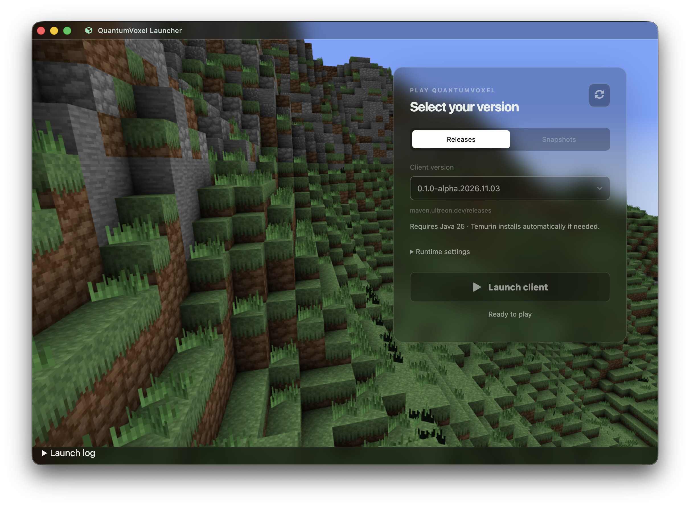

# QuantumVoxel Launcher

Electron launcher for `net.quantumvoxel:client`, with version discovery from:

- https://maven.ultreon.dev/releases
- https://maven.ultreon.dev/snapshots



## Run

Install Node.js. Java and Apache Maven are downloaded and managed automatically when needed.

```sh
npm install
npm run dev
```

Select Releases or Snapshots, choose a version, and click **Launch client**. A missing repository is reported independently so the other repository remains usable. Refresh checks Maven metadata again. Runtime settings are saved locally.

Maven resolves the client and its transitive runtime dependencies, including native JARs, through the Ultreon repositories, Maven Central, Fabric, and JitPack. Snapshot dependencies are refreshed on launch. Java runs `net.quantumvoxel.client.Main` with the resolved classpath and selected maximum heap. The launch log shows Maven and client output, including resolution or Java compatibility errors.

Client POMs and classpath files are stored under the Electron user-data directory in `clients/<repository>/<version>`. Game files use its `game` directory. Maven maintains its normal local dependency cache. A running client continues independently if the launcher is closed.

```sh
npm run build
npm start
```

The repository also contains unused starter components; the full `npm run typecheck` currently reports pre-existing errors in those components (missing optional dependencies and browser APIs).


## Automatic Java runtime

The launcher reads org.gradle.jvm.version from the runtime variants in each client .module file, including timestamped snapshot metadata. The requirement appears beside the selected version and is checked again on launch. Missing or invalid metadata stops launch with an error instead of assuming a Java version.

A compatible preferred/system Java is reused. Otherwise, a matching Eclipse Temurin JDK is downloaded from Adoptium for the current OS and architecture, verified against its SHA-256 checksum, extracted and checked, then cached under runtimes in the launcher user-data directory. Downloads and extraction progress appear in the launch status/log. Partial installations are never selected. JAVA_HOME and PATH are set for Maven and the client without changing system settings.


## Automatic Maven

At each launch the launcher checks Maven Central for the latest stable Maven 3 release (3.9+). Missing or newer versions are downloaded, verified with the published SHA-512 checksum, extracted and tested using the selected Java runtime. Installations are cached under tools/maven in the launcher user-data directory; no system installation or PATH changes are needed. If an update check or download fails, a verified cached Maven is reused when available. Pre-release Maven 4 builds are excluded.

Leave the Maven executable setting blank for automatic management. The old default mvn also selects automatic management. An explicit executable path uses that installation and disables managed updates for the override.

